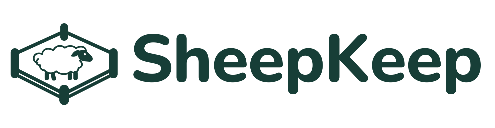

# SheepKeep

<picture>
  <source media="(prefers-color-scheme: dark)" srcset="docs/assets/sheepkeep-lockup-dark.svg">
  
</picture>

SheepKeep is a self-hosted home inventory. Use the web app or the iPhone companion to record what
you own, where you keep it, and when it moved.

## Features

- Organize items in places and boxes. Check an item's history or last location photo when you
  need to find it.
- Print QR labels or use NFC tags to open the linked record on iPhone.
- Capture inventory, photos, and documents offline on iPhone and sync when you reconnect.
- Search photos by text or by example image with the opt-in visual index.
- Map rooms in 3D with shapes such as adjustable shelving and water purifiers.
  [Map shapes](apps/docs/src/content/docs/users/map-shapes.mdx)
- Use a personal token to manage warranties, vendors, tags, and item lifecycle through MCP.
  [MCP clients](apps/docs/src/content/docs/users/mcp-clients.md)

## Run from source

Install Docker with Compose v2 and Buildx. From a fresh checkout, build the image and initialize
the instance.

```sh
git clone https://github.com/e3742526/kept-nfc.git sheepkeep
cd sheepkeep
docker buildx build --load --build-arg REVISION="$(git rev-parse HEAD)" -t sheepkeep:local .
docker compose run --rm init
docker compose up -d
```

Choose the address people will use to open SheepKeep. The initializer writes it to `.env` and
prints a setup code. Once the stack is up, open that address and enter the code to create the
first admin account.

Use HTTPS for the iPhone app and browser camera features. For an existing installation, keep its
Compose project name, volumes, and public URL. [HTTPS setup](apps/docs/src/content/docs/install/home-network.md) ·
[Upgrade runbook](docs/runbooks/upgrade.md)

## Documentation

- Build the companion app, set up signing, and test on a device. [iPhone setup](apps/ios/README.md)
- Configure labels and run backup or restore procedures. [Operator runbooks](docs/README.md#operate-sheepkeep)
- Set up the development database and run focused checks. [Contributor guide](CONTRIBUTING.md)
- Find specifications, design references, and qualification records. [Documentation index](docs/README.md)

## Repository layout

| Path | Contents |
| --- | --- |
| [`apps/`](apps/) | Web app, server, iPhone app, and documentation site |
| [`packages/`](packages/) | Shared types and schemas, and MCP tool contracts |
| [`docs/`](docs/) | Runbooks, release notes, test scenarios, and engineering references |
| [`scripts/`](scripts/) | Repository checks, release tooling, and verification scripts |
| [`docker/`](docker/), [`charts/`](charts/), [`homeassistant/`](homeassistant/) | Deployment and packaging files |

## Upstream and license

SheepKeep, formerly Kept NFC, is an independent fork of [Kept](https://github.com/keptinventory/kept),
created by [Ibrahim Roshdy](https://github.com/ibrahimroshdy) and developed with its contributors.
[Upstream credits and compatibility](UPSTREAM.md) · [Citation](CITATION.cff)

SheepKeep is licensed under the [GNU Affero General Public License, version 3](LICENSE). The app's
**Source code** link points to the corresponding source, and the image serves third-party notices at
`/notices.txt`. [Security reporting](SECURITY.md)
